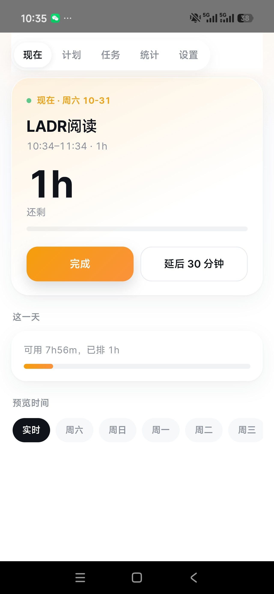
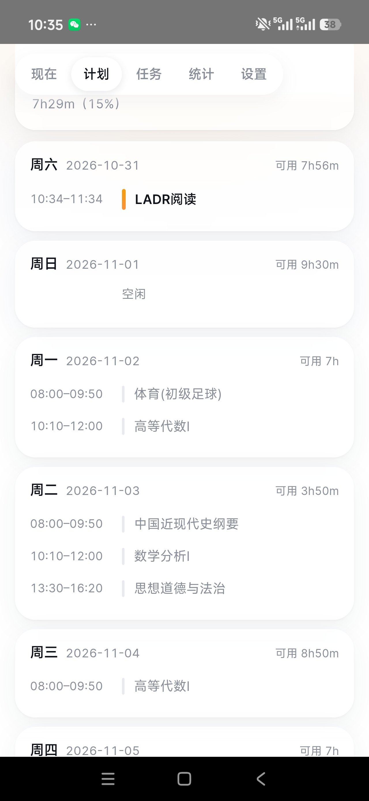
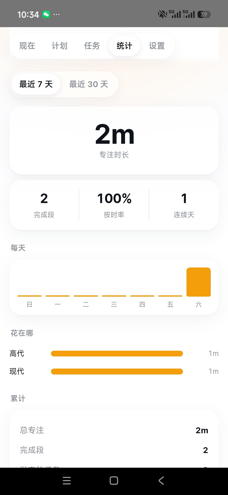
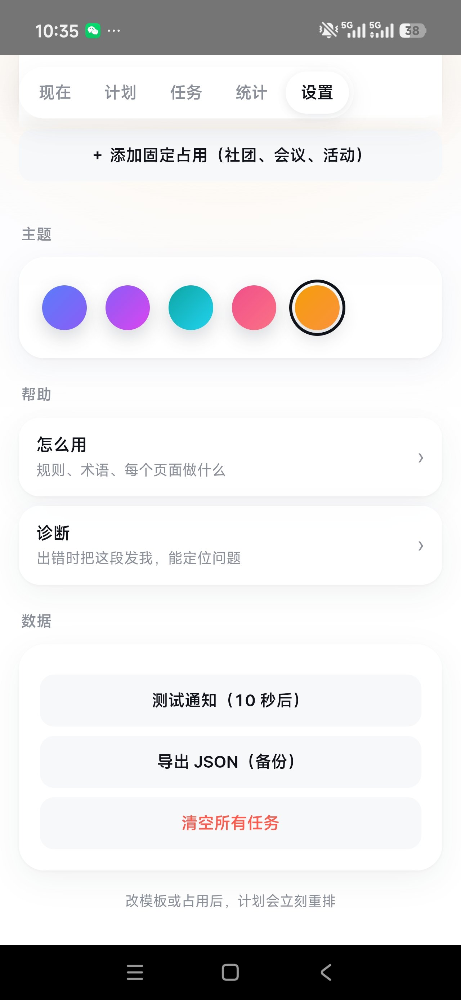

# time-assistant

一个会**替你排具体时段**的学生任务管理器。填任务（重要度、预计时长、截止时间），它结合你的课表和可用时间，把它们排进未来 7 天，到点提醒。

<p align="center">
  
  
  
  
</p>

## 和普通待办有什么不同

普通待办只给你一个倒计时。这里多一个数：**可行性压力**。

```
R = 剩余工作量
A = 从现在到截止，你真正能用的空档（已扣课表、已扣留白）
p = R / A          压力
```

「三天后交但你这三天只有 4 小时空」比「下周交但下周有 20 小时空」更急——只看日期远近的待办给不出这个判断。

排程按 `重要度 × 紧急度` 加权排序，一根滑杆调两者比重。每天只填 85% 的空档（留白），每节课前后各留 10 分钟赶路。

## 功能

- 任务：星级重要度、预计时长、任意远期截止
- 三种拆分：不拆 / 自由拆（系统按空档切）/ 分段（每次 X 分钟 × N 次）
- 时间模板：按天多段，可整组（工作日 / 周末）编辑
- 固定占用：每周重复 / 一次性 / 学期课（带单双周规则），可多选星期
- 学期开关：放假一键关掉整张课表，数据保留
- 打勾记账、超时确认、作废与顺延
- 统计：专注时长、按时率、连续天数、科目分布
- 5 套主题色
- 系统通知（精确闹钟）
- 本地诊断日志

## 架构

刻意做得极小（APK 约 140 KB）：

```
engine/     纯函数排程引擎，零依赖，浏览器和 Node 都能跑
web/        原生 JS 界面，无框架无构建步骤
data/       种子数据（ES 模块，file:// 下也能加载）
apk/        WebView 外壳 + 通知，手写二进制清单打包
tests/      node:test
```

- **没有打包工具链**：不用 npm、不用 webpack、不用 Gradle
- **没有第三方 SDK**：体积就是自己代码的体积
- **引擎不认识 DOM，界面不认识排程**：逻辑用命令行就能验证

## 构建 APK

前置：JDK 17+、Node 18+，以及 `tools/` 里的三个 jar（见 `tools/README.md`）。

```bash
# 1. 生成图标
node apk/make-icons.js

# 2. 一键构建 + 签名
./apk/build.sh
```

`apk/build.sh` 会走：`javac` → `r8/D8` 出 dex → `pack.js` 手写二进制 `AndroidManifest.xml` + `resources.arsc` + zip → `uas.jar` 签名。

**签名证书和密码都不随仓库提供。** 先生成一张证书：

```bash
keytool -genkeypair -keystore apk/keystore/time-assistant.keystore -alias timeassistant \
  -keyalg RSA -keysize 2048 -validity 10000 \
  -storepass 你的密码 -keypass 你的密码 -storetype PKCS12 \
  -dname "CN=your-name, O=you, C=CN"
```

再提供密码（`build.sh` 不存密码，二选一）：

```bash
export KS_PASS=你的密码          # 方式一：环境变量
```

```ini
# 方式二：apk/keystore.properties（已在 .gitignore 里）
KS_ALIAS=timeassistant
KS_PASS=你的密码
```

路径和别名要改的话：`apk/build.sh` 顶部有 `KS=` 和 `KS_ALIAS` 的默认值，可用同名环境变量覆盖。

## 在浏览器里开发

不用每次打包。一条命令起个静态服务：

```bash
cd scheduler && node serve.js
# http://127.0.0.1:8090/web/
```

改完刷新即可。界面加载的就是 `engine/` 里的同一份代码，和 APK 里跑的一模一样。

## 测试

```bash
cd scheduler
node --test tests/*.test.js
```

26 条：6 条不变式（不撞课、不重叠、块够大、排不下必须报、留白上限…）+ 8 个对抗场景 + 6 条跨周滚动 + 2 条版本一致性 + 快照。

push 和 PR 会在 GitHub Actions 里自动跑一遍（`.github/workflows/test.yml`）。

快照锁的是排程输出文本，改动算法后会红——确认是有意为之再更新：

```bash
UPDATE_SNAPSHOT=1 node --test tests/snapshot.test.js
```

遇到问题时，App 里 **设置 → 诊断 → 复制报告**，贴到 issue 里就行。

## 已知限制

- 课表从教务系统导出不了，只能手输（或截图转 JSON）
- 提醒依赖系统精确闹钟权限，国产 ROM 可能需要手动放行
- 没有云同步，数据只在本机
- 排程窗口固定 7 天，更远的任务只参与「压力」计算，不落块

## License

MIT
