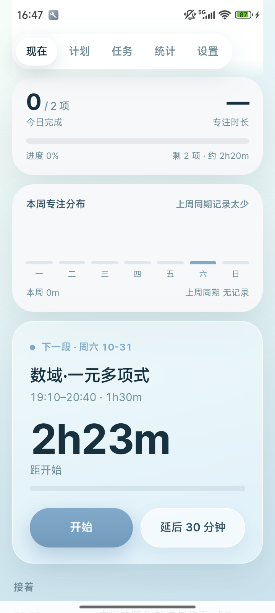
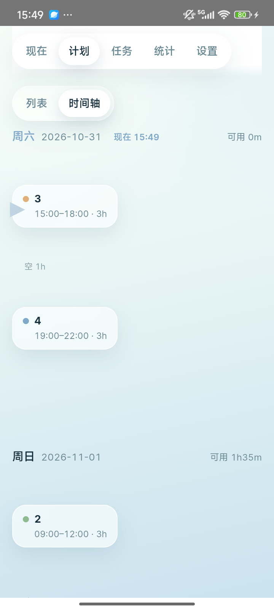
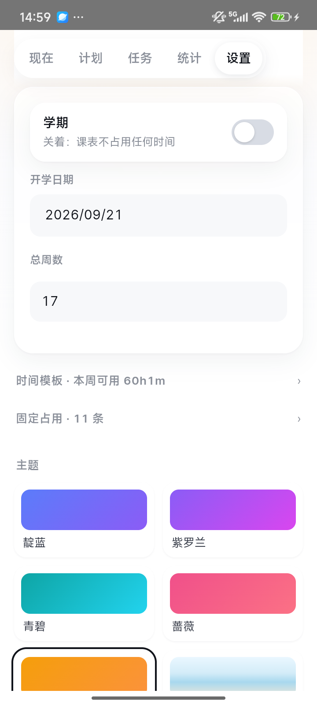

# time-assistant

**一个会替你排具体时段的待办 App。**

填任务（重要度、预计时长、截止时间），它结合你的课表和空闲时间，把任务排进
「今天 19:10–20:40」这种具体时段，到点提醒。

<sub>v1.0.0 · Android 8.0+ · 170 KB · 不联网 · 不要账号 · 零第三方依赖</sub>

**[下载 APK](dist/time-assistant-1.0.0.apk)** ·
[更新日志](CHANGELOG.md) ·
[怎么用](#怎么用) ·
[自己构建](docs/BUILD.md)

<p align="center">
  
  
  
  
</p>

---

## 和普通待办有什么不同

普通待办只给你一个倒计时。这里多一个数：**可行性压力**。

```
R = 剩余工作量
A = 从现在到截止，你真正能用的空档（已扣课表、已扣留白）
p = R / A          压力
```

「三天后交但你这三天只有 4 小时空」比「下周交但下周有 20 小时空」更急——
只看日期远近的待办给不出这个判断。

排程按 `重要度 × 紧急度` 加权排序，一根滑杆调两者比重。每天只填 85% 的空档（留白），
每节课前后各留 10 分钟赶路。

## 功能

**排程**

- 任务：星级重要度、预计时长、任意远期截止
- 三种拆分：不拆 / 自由拆（系统按空档切）/ 分段（每次 X 分钟 × N 次）
- 有多少排多少：跨度跟着最远截止日走（7–120 天），不固定在某一周
- 时间模板：按天多段，可整组（工作日 / 周末）编辑
- 固定占用：每周重复 / 一次性 / 学期课（带单双周规则），可多选星期
- 学期开关：放假一键关掉整张课表，数据保留
- **计划可编辑**：点任意一段改时间，改完锁定，其余自动重排（冲突有校验）

**执行**

- 打勾记账、超时确认、作废与顺延
- 完成即进休息（5–20 分钟，按块长算），计划先冻结不重排；休息结束前可选择继续歇或提前做下一段
- 「开始」= 立刻把这段挪到现在
- 系统通知（精确闹钟）

**看数据**

- 首页仪表盘：今日完成 / 专注时长 / 本周专注分布（较上周同期）
- 统计：专注时长、按时率、连续天数、科目分布、每日柱状
- 计划页两种看法：列表 / 时间轴
- 分享为图片：一周计划导成 1080 宽长图

**外观**

- 四种界面风格：普通 / 玻璃 / 深色 / 考卷
- 风景主题：海岸、雪原、丹顶鹤、柴犬（纯 CSS + 手绘 SVG，零图片）
- 左右滑动切页、沉浸式铺满屏幕

## 怎么用

1. **设置 → 学期**：填开学日期和总周数
2. **设置 → 时间模板**：填你每天几点到几点有空（这决定了任务能排到哪）
3. **设置 → 固定占用**：把课表加进去（支持单双周）
4. **任务**：加一件，填重要度、预计时长、截止时间
5. **计划**：看它把自己排到哪；不满意就点那块改时间，改完会锁定
6. **现在**：到点提醒，做完打勾；打完会自动进入休息

第一次用建议只加两三件任务，看看排出来的结果合不合你的作息，再批量录入。

## 更新日志

### 1.0.0 — 2026-10-31

- **有多少排多少**：排程跨度跟着最远截止日走，不再固定 7 天
- **计划可编辑**：点块改时间 → 锁定 → 其余自动重排，冲突会被拦下
- **完成即休息**：做完不立刻重排，多出来的时间归你（可以歇，也可以提前做下一段）
- 「开始」按钮真正可用，延后 30 分钟不再是空壳
- 四种界面风格（玻璃 / 深色 / 考卷 / 普通）+ 四个风景主题
- 计划页时间轴视图、首页仪表盘、分享为图片、左右滑动切页
- 测试 36 → 61 条；排程最坏耗时 153ms → 15.7ms

完整记录见 [CHANGELOG.md](CHANGELOG.md)。

## 架构

刻意做得极小（APK 约 170 KB）：

```
engine/     纯函数排程引擎，零依赖，浏览器和 Node 都能跑
web/        原生 JS 界面，无框架无构建步骤
apk/        WebView 外壳 + 通知，手写二进制清单打包
tests/      node:test
```

- **没有打包工具链**：不用 npm、不用 webpack、不用 Gradle
- **没有第三方 SDK**：体积就是自己代码的体积
- **引擎不认识 DOM，界面不认识排程**：逻辑用命令行就能验证

## 已知限制

- 课表要手动录，**不支持从教务系统导入**
- 统计只到「本周 / 上周同期」，没有 12 周趋势
- 编辑块只能改同一天（跨天要分两步）
- 没有撤销
- 只有 Android
- 提醒依赖系统精确闹钟权限，国产 ROM 可能需要手动放行

## 开发

构建 APK、跑测试、真机回归、存档备份工具都在 [docs/BUILD.md](docs/BUILD.md)。

遇到问题：App 里 **设置 → 诊断 → 复制报告**，贴到 issue 里。

## License

MIT
